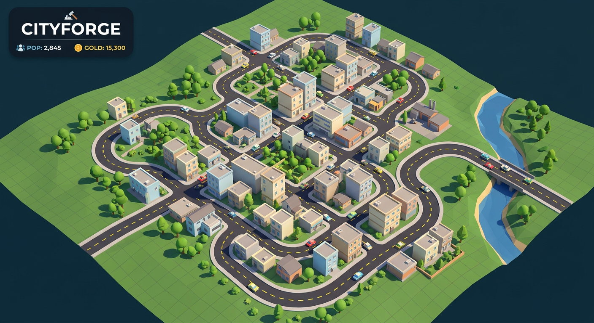

# CityForge

A free-form **3D city builder** for Android, built with **Godot 4.4**. Roads are
true 3D curves (straight, diagonal, curved and circular) generated from a
`Curve3D` and sampled into geometry. Paint zones on the grid and watch them grow
into buildings that feed the city economy, with traffic that follows the real
road paths. Everything is generated in code — the whole project is a handful of
text files with no binary asset dependencies.



## Features

- ✏️ **Free-form roads** — drag to draw; curves, diagonals and closed rings all work.
- 🏙️ **Zoning** — residential, commercial, industrial and parks, each with its own economy.
- 🏗️ **Procedural buildings** that grow in when a zone is placed.
- 🚗 **Traffic** that drives along the baked road curves.
- 🎥 **Full camera control** — one-finger pan, pinch-to-zoom, mouse wheel, `Q`/`E` to rotate.
- 🧨 **Bulldozer** to remove roads and zones (with a partial refund).
- 💾 **Save / load** — your city is written to `user://cityforge_save.json` and restored on launch.
- 📱 **Mobile-first UI** that scales to any screen, plus keyboard shortcuts on desktop.

## Controls

| Action            | Touch                    | Mouse / Keyboard              |
|-------------------|--------------------------|-------------------------------|
| Build a road      | Drag in **Roads** mode   | Left-drag                     |
| Paint a zone      | Drag in **Zones** mode   | Left-drag                     |
| Demolish          | Drag in **Snos** mode    | Left-drag                     |
| Pan the camera    | **Camera** mode, or two fingers | Right / middle mouse drag |
| Zoom              | Pinch                    | Mouse wheel                   |
| Rotate view       | —                        | `Q` / `E`                     |
| Switch tool       | Toolbar buttons          | `1` `2` `3` `4`               |
| Cancel drawing    | Second finger down       | `Esc`                         |

## Graphics

The world is textured with a small set of 512px seamless textures generated for
the project (asphalt roads with baked UVs, grass ground, water, and per-zone
building facades). The app ships a custom raster icon (`icon.png`) and a boot
splash (`splash.png`). Everything else — buildings, trees, cars, roads — is
generated procedurally in code, so the APK stays small.

## Project layout

```
project.godot          Godot project settings (GL Compatibility, landscape)
export_presets.cfg     Android export preset (lightweight, no Gradle/keystore)
icon.png               App icon
splash.png             Boot splash image
textures/              Seamless world & facade textures (+ .import files)
scenes/main.tscn       Main scene
scripts/main.gd        All gameplay logic
.github/workflows/     CI that builds build/CityForge.apk
docs/preview.png       Promo/preview image
```

## Building the APK

### In the Godot editor

1. Open the project in **Godot 4.4**.
2. Install the **Android export templates** (Editor → Manage Export Templates).
3. **Project → Export → Android → Export Project** to `build/CityForge.apk`.

The preset uses the prebuilt export templates (`gradle_build/use_gradle_build=false`),
so you don't need the Android SDK or a signing keystore for a debug/unsigned build.

### Via GitHub Actions

Push to `main` (or run the workflow manually from the **Actions** tab). The
`Build CityForge Android` workflow installs Godot 4.4.1 and the export
templates, validates the project and exports the APK, which is uploaded as the
`cityforge-release-apk` artifact.

## Development

There is no build step for the game logic — edit `scripts/main.gd` and press
play. The code is organised into clearly-labelled sections (environment, world,
buildings, roads, input, actions, UI, save/load).
